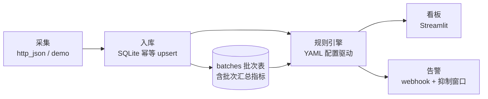

# 数据质量监控平台（dq-monitor）

一个可上线的轻量数据质量巡检系统：定时采集多个公开数据源，用配置化的规则校验数据质量，异常结果进看板并通过企业微信 / Server酱告警。

面向数据开发、测试开发、数据运维方向的作品集项目，刻意做小、做完整，每一层都能在面试里被追问。

## 亮点

- **配置驱动**：数据源和规则全部写在 YAML 里，新增一个源 / 一条规则不改代码
- **9 种规则类型**：非空率、唯一性、数值区间、枚举白名单、格式正则、字段漂移、数据时效、环比波动、行数水位
- **幂等采集**：以业务主键 upsert，重复跑不会产生重复数据；每个批次单独记账，失败也留痕
- **告警可克制**：同一规则在抑制窗口内只推送一次，避免告警风暴
- **可验证**：28 个测试，覆盖每条规则的边界 + 流水线 + 看板渲染

## 架构



四个表各司其职：`batches` 记批次与批次级汇总（环比规则的基线来源）、`records` 只留最新快照、`rule_results` 供看板查询、`alert_state` 做告警去重。

## 快速开始

```bash
python -m venv .venv && source .venv/bin/activate   # Windows: .venv\Scripts\activate
pip install -r requirements.txt

python -m dq.cli init            # 建表
python -m dq.cli seed --days 14  # 造 14 天演示数据（离线源，不需要联网）
python -m dq.cli serve           # 浏览器打开 http://localhost:8501
```

真实数据源（需要外网）：

```bash
python -m dq.cli run                 # 跑全部数据源
python -m dq.cli run --source github_repo
python -m dq.cli run --source demo_order --anomaly 1   # 注入值级异常，看规则怎么报
python -m dq.cli run --source demo_order --anomaly 2   # 注入字段漂移
python -m dq.cli rules               # 打印规则清单
```

## 目录结构

```
dq-monitor/
├── config/
│   ├── sources.yaml        # 数据源定义（url / 字段映射 / 主键）
│   └── rules.yaml          # 规则定义（类型 / 字段 / 阈值 / 级别）
├── dq/
│   ├── config.py           # YAML -> 强类型对象，环境变量覆盖
│   ├── pipeline.py         # 采集 -> 落库 -> 校验 -> 告警 的编排
│   ├── cli.py              # 命令行入口
│   ├── collectors/         # 采集器（http_json / demo），注册表模式
│   ├── storage/            # 建表 SQL + SQLite 访问层
│   ├── rules/              # checks.py（规则实现）+ engine.py（调度）
│   ├── alerting/           # webhook 推送 + 去重
│   └── dashboard/          # Streamlit 看板
├── tests/                  # 规则单测 / 流水线集成测试 / 看板冒烟测试
└── .github/workflows/      # CI + 每日巡检
```

## 换成你自己的数据源

改 `config/sources.yaml`，三步：

```yaml
sources:
  - name: my_api
    type: http_json
    url: "https://your-api/xxx"
    list_path: data.items        # 列表在返回体里的路径，支持 a.b.c；根节点就是列表时留空
    key_field: id                # 业务主键，决定幂等粒度
    fields:                      # 左边是你的字段名，右边是接口返回的字段路径
      id: id
      amount: payload.amount
      created_at: createTime
```

如果返回结构特殊（XML、分页、需要签名），在 `dq/collectors/` 加一个子类，用 `@register` 注册即可，流水线无需改动。

## 加一条规则

```yaml
- id: order.amount.range
  type: range
  source: demo_order
  field: amount
  level: fail            # fail 触发告警，warn 只上板
  params: { min: 0.01, max: 100000 }
  desc: 订单金额需在合理区间
```

| 类型 | 用途 | params |
| --- | --- | --- |
| `not_null` | 非空率 | `min_pass_rate` |
| `unique` | 主键唯一 | — |
| `range` | 数值区间 | `min` / `max` / `allow_null` |
| `enum` | 枚举白名单 | `allowed[]` / `allow_null` |
| `pattern` | 格式正则 | `regex` |
| `schema` | 字段漂移 | `expected_fields[]` |
| `freshness` | 数据时效 | `max_lag_hours` |
| `volatility` | 环比波动 | `agg` / `metric` / `max_change_pct` |
| `row_count` | 行数水位 | `min_rows` / `max_rows` |

## 部署上线（拿公网链接）

**方式 A：Streamlit Community Cloud（最省事，推荐）**

1. 代码推到 GitHub public 仓库
2. 打开 share.streamlit.io，新建 app，入口填 `dq/dashboard/app.py`
3. Settings → Secrets 里加 `DQ_DB = "data/dq.db"`（可选）
4. 让云端看板有数据：本地 `python -m dq.cli run` 后执行 `git add -f data/dq.db && git commit -m "data" && git push`

`patrol` 工作流每天跑完会把数据库提交回仓库，Streamlit Cloud 检测到 commit 会自动重新部署，所以看板一直是新的。

**方式 B：Docker（任意云主机 / Render / Railway）**

```bash
docker build -t dq-monitor .
docker run -p 8501:8501 -v $(pwd)/data:/app/data dq-monitor
```

**方式 C：只用 GitHub Actions 产出报告**，不部署看板（把 `rule_results` 导成 Markdown 附到 job summary）。

## 建议的改造节奏（14 天版）

| 阶段 | 做什么 | 交付物 |
| --- | --- | --- |
| D1–2 | 跑通骨架，换掉 demo 源为你想监控的真实数据源 | 能采集到自己的数据 |
| D3–4 | 补充采集健壮性：分页、超时、失败重试、增量水位 | 采集层单测 |
| D5–7 | 加规则：优先写 2 条你自己业务里真的会踩坑的规则 | 9 种类型各至少 1 条 |
| D8–10 | 看板加 1–2 个你自己想的图（如规则命中 TOP、源健康度） | 公网可访问的看板 |
| D11–12 | 接企业微信机器人，验证抑制窗口生效 | 手机上能收到告警截图 |
| D13–14 | README、架构图、2 分钟演示录屏 | 简历里的链接 |

## 简历怎么写

> - 独立设计实现数据质量监控平台，覆盖 N 个数据源、M 条可配置规则，日校验 X 条记录，异常发现延迟 < 5 分钟（在线演示：链接）
> - 基于 GitHub Actions 实现每日定时巡检与自动告警，通过去重抑制窗口将同类告警重复率从每日 N 条降到 1 条
> - 用 pytest 覆盖 9 类规则边界与流水线幂等性，共 28 个用例，CI 中零外部依赖跑通端到端

数字都填你真实跑出来的，别编。面试官大概率会问「日校验 X 条」是怎么统计的。

## 面试可能追问的点

- **为什么规则要做成配置而不是硬编码？** 规则会随业务变，配置化让新增规则从「改代码 + 发版」变成「改 YAML」，也方便非开发同学参与。
- **幂等怎么保证？** 业务主键 + `ON CONFLICT DO UPDATE`，同一批数据重复跑不会膨胀；批次表按批次记账，所以历史可追溯。
- **环比规则的基线从哪来？** 明细表只留最新快照，所以每批入库时把 mean/sum/count 算好存进 `batches.metrics`，下一批直接比。
- **告警风暴怎么防？** `alert_state` 记录每条规则上次推送时间，窗口内静默；`fail` 与 `warn` 分级，warn 只上板不推送。
- **为什么用 SQLite？** 单写入方、数据量小、零运维成本；要上量就换 Postgres，改动集中在 `dq/storage/db.py`（SQL 都是标准语法）。
- **字段漂移为什么用「字段缺失」而不是类型校验？** 上游改接口最常见的表现是删字段/改名，类型变了通常直接报解析错，缺失是静默的、更危险。

## 已知取舍

- 明细表只存最新快照，不做全量历史（历史靠批次汇总指标），这是为了控制体积；真要留历史，加一张 `records_history` 按批次存即可。
- 没有用户体系与权限，看板是只读的，公开链接即可访问。
- 调度依赖 GitHub Actions 的 cron，没有自建调度器；cron 有几分钟抖动，对日级巡检够用。
